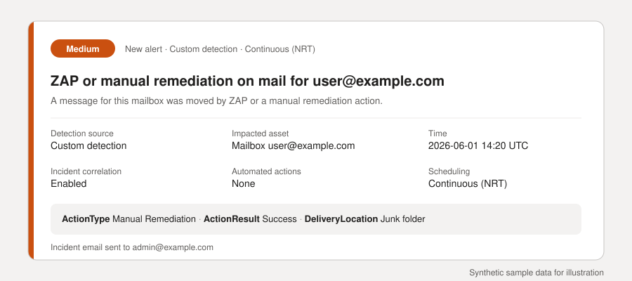
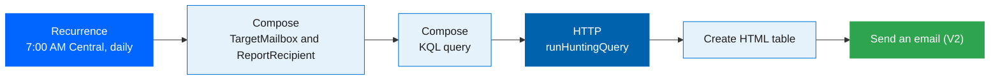
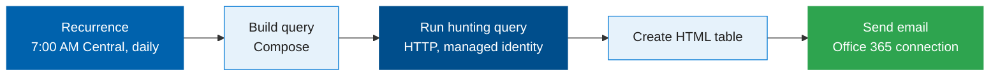
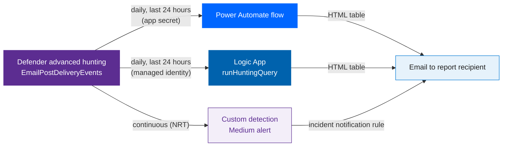
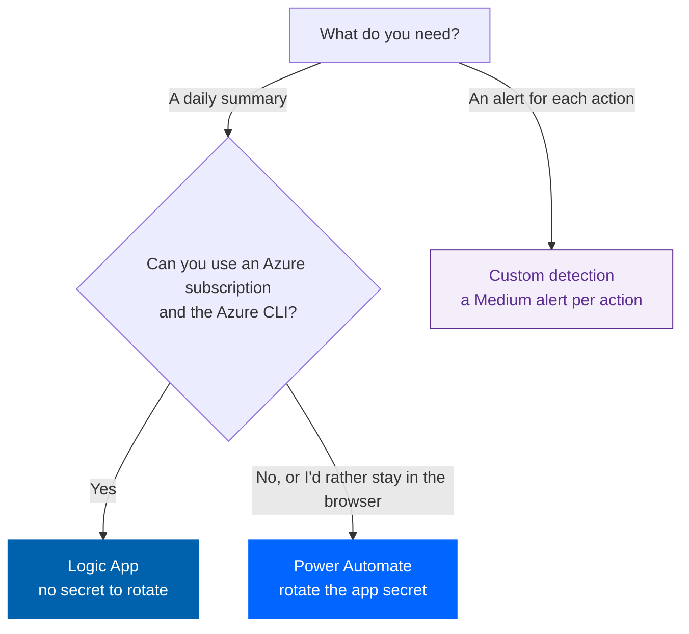
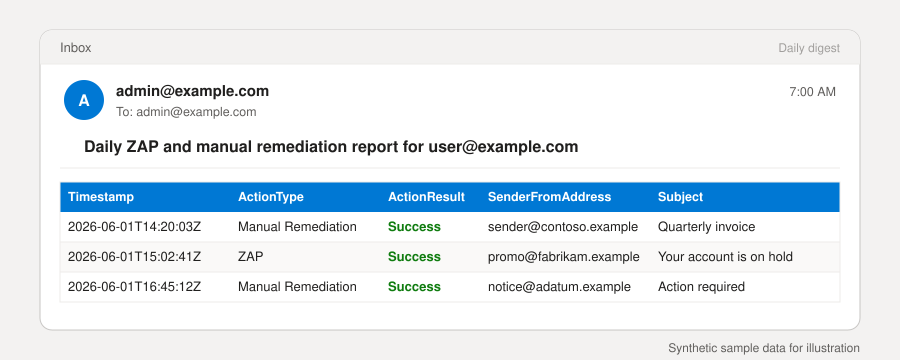

# Daily ZAP and manual remediation digest

[](https://learn.microsoft.com/defender-xdr/custom-detection-rules)
[](https://learn.microsoft.com/power-automate/)
[](https://learn.microsoft.com/azure/logic-apps/authenticate-with-managed-identity)
[](https://learn.microsoft.com/graph/api/security-security-runhuntingquery)
[](../LICENSE)

Get a daily email of zero-hour auto purge (ZAP) and manual remediation actions for one mailbox from Microsoft Defender advanced hunting, plus an alert for each new action. This folder covers three options, each with a step-by-step text guide.

> [!IMPORTANT]
> This is a community sample, provided as-is. It isn't a supported Microsoft product. Test it in a lab tenant first. Tenant-specific screenshots and run details are omitted from this public version.

Defender shows ZAP and manual remediation actions in Explorer one event at a time. It doesn't send a daily summary for one mailbox, and it doesn't alert on each action by default. This folder covers both.

## Start here

Pick an option, then follow its steps. The diagrams and sample output are illustrative.

<table>
<tr>
<td align="center" width="33%" valign="top"><a href="#power-automate-digest"></a><br><sub>18 steps · no code · app secret</sub></td>
<td align="center" width="33%" valign="top"><a href="#logic-app-digest"></a><br><sub>7 steps · managed identity · no secret</sub></td>
<td align="center" width="33%" valign="top"><a href="#custom-detection"></a><br><sub>12 steps · alert for each action</sub></td>
</tr>
</table>

Also: [Choose an option](#choose-an-option) · [Test before production](#test-before-production) · [Limits](#limits) · [Files](#files)

## Choose an option

<table>
<tr>
<td width="33%" valign="top"><a href="#power-automate-digest"><b>1. Power Automate flow</b></a><br><sub>A daily digest with no programming. It signs in with an app secret that you rotate before it expires.</sub></td>
<td width="33%" valign="top"><a href="#logic-app-digest"><b>2. Logic App</b></a><br><sub>The same digest, signed in with a managed identity. There's no secret to store or rotate.</sub></td>
<td width="33%" valign="top"><a href="#custom-detection"></a><br><b>3. Custom detection</b><br><sub>A continuous (NRT) rule that raises a Medium alert for each action. Defender emails the incident.</sub></td>
</tr>
</table>

### At a glance

| | Power Automate | Logic App | Custom detection |
|---|---|---|---|
| **Sends** | A daily HTML table | A daily HTML table | One alert per action, plus an incident email |
| **When** | 7:00 AM Central, every day | 7:00 AM Central, every day | Continuous (near real time) |
| **Signs in as** | An Entra app with a client secret | Its managed identity | Defender, with no sign-in to manage |
| **Secret to rotate** | ⚠️ Yes. Set an expiry and rotate it before then. | ✅ No | ✅ No |
| **Code to deploy** | One KQL query, pasted into the flow | One ARM template, which includes the query | One KQL query, pasted into the rule |
| **Needs** | A Power Automate plan with premium connectors | An Azure subscription and the Azure CLI | Defender XDR advanced hunting |

## Power Automate digest

This section builds the daily digest as a Power Automate flow, step by step. The flow runs the same query as the [Logic App digest](#logic-app-digest), but it signs in to Microsoft Graph with an app secret instead of a managed identity.

You need:

- Microsoft Defender XDR with advanced hunting, and data in `EmailPostDeliveryEvents`.
- Rights to register an app in Microsoft Entra ID, and rights to grant admin consent for a Microsoft Graph application permission.
- A Power Automate plan that includes premium connectors. The HTTP action is premium.
- An Office 365 Outlook connection for the account that sends the digest.



### Step 1. Open App registrations

1. In the Microsoft Entra admin center, open **App registrations**.
2. Select **New registration**.

### Step 2. Register the app

1. Enter a name, for example `zap-daily-report-reader`.
2. Keep **Supported account types** on **Single tenant only**.
3. Select **Register**.

### Step 3. Note the client ID and tenant ID

Open the app's **Overview**. Copy **Application (client) ID** and **Directory (tenant) ID**. You need both in step 11.

### Step 4. Add the Microsoft Graph permission

1. Open **API permissions** > **Add a permission** > **Microsoft Graph** > **Application permissions**.
2. Search for `ThreatHunting`, expand **ThreatHunting (1)**, and tick **ThreatHunting.Read.All**.
3. Select **Add permissions**.

### Step 5. Grant admin consent

Select **Grant admin consent for** your tenant, and confirm. The permission shows **Granted**.

### Step 6. Create a client secret

1. Open **Certificates & secrets** > **New client secret**.
2. Enter a description, and keep **Expires** on **Recommended: 180 days (6 months)**.
3. Select **Add**, then copy the **Value** right away. Entra shows it only once.

Store the value in a password manager. Never paste it into a file, an email, or a screenshot.

### Step 7. Create the flow

1. In Power Automate, select **Create** > **Scheduled cloud flow**.
2. Enter a flow name, for example `zap-daily-report (Power Automate)`.
3. Set **Repeat every** to **1 Day**. You set the time in step 8.
4. Select **Create**.

### Step 8. Set the recurrence trigger

1. Select **Recurrence** and set **Interval** to 1 and **Frequency** to **Day**.
2. Set **Time zone** to **(UTC-06:00) Central Time (US & Canada)**, **At these hours** to 7, and **At these minutes** to 0.

The preview reads "Runs at 7:00 every day".

### Step 9. Add the TargetMailbox compose

1. Add a **Compose** action and rename it `TargetMailbox`.
2. In **Inputs**, enter the mailbox to report on, for example `user@example.com`.

### Step 10. Add the ReportRecipient compose

1. Add another **Compose** action and rename it `ReportRecipient`.
2. In **Inputs**, enter the address that receives the digest, for example `admin@example.com`.

### Step 11. Add the query

1. Add a **Compose** action named `Compose`.
2. Paste the query from [queries/zap-daily-report.kql](queries/zap-daily-report.kql) on **one line**, and replace the mailbox address with the **TargetMailbox** output. The designer shows that output as **Outputs**.

A newline would break the JSON body in step 12.

```kusto
EmailPostDeliveryEvents | where Timestamp > ago(1d) | where ActionType has 'ZAP' or ActionType has 'Manual' | where RecipientEmailAddress =~ '@{outputs('TargetMailbox')}' | join kind=leftouter (EmailEvents | where Timestamp > ago(1d) | project NetworkMessageId, Subject) on NetworkMessageId | project Timestamp, ActionType, ActionResult, RecipientEmailAddress, SenderFromAddress, Subject, DeliveryLocation, ThreatTypes, NetworkMessageId | order by Timestamp desc | take 500
```

### Step 12. Add the HTTP action

Add the built-in **HTTP** action. Don't use **HTTP with Microsoft Entra ID**. That connector signs in as a user, so it doesn't use the app permission.

- **URI:** `https://graph.microsoft.com/v1.0/security/runHuntingQuery`
- **Method:** POST
- **Headers:** `Content-Type` = `application/json`
- **Body:** `{"Query": "<Compose output>", "Timespan": "P30D"}`. The **Query** value is the output of the **Compose** query action, shown as **Outputs**.

### Step 13. Set the HTTP authentication

Under **Authentication**, set:

- **Authentication type:** Active Directory OAuth
- **Authority:** `https://login.microsoftonline.com`
- **Tenant:** the directory (tenant) ID from step 3
- **Audience:** `https://graph.microsoft.com`
- **Client ID:** the application (client) ID from step 3
- **Credential type:** Secret
- **Secret:** the value from step 6

> [!WARNING]
> The designer shows the secret in clear text, and so does Code view. Don't screenshot the Secret field, and don't share the flow's code.

### Step 14. Create the HTML table

Add **Create HTML table**:

- **From:** the **results** output of the HTTP action, which is `body('HTTP')?['results']`.
- **Format:** HTML

### Step 15. Send the digest

Add **Send an email (V2)** from Office 365 Outlook:

- **To:** the **ReportRecipient** output
- **Subject:** `Daily ZAP and manual remediation report for ` followed by the **TargetMailbox** output
- **Body:** the output of **Create HTML table**

The designer reads "Connected to Office 365 Outlook" when the connection is good.

### Step 16. Save and check the flow

1. Select **Save**.
2. Open **Flow checker**. It should show **Errors (0)** and **Warnings (0)**.

### Step 17. Turn on, run, and check the history

1. Make sure the flow is **Enabled**. The toggle sits at the top of the flow page.
2. To test now, select **Run**. Running from the details page needs the flow to be on.
3. Check the **28-day run history**. Each scheduled run appears at 7:00 AM Central, with its status.

### Step 18. Rotate the secret before it expires

Create a new client secret in the app (step 6), paste its value into the **Secret** field (step 13), select **Save**, and run the flow once. Check that the run succeeds and the digest arrives. Then delete the old secret in Entra.

An app can hold two secrets at once, so the old secret keeps working until you delete it.

### Power Automate troubleshooting

| Symptom | Likely cause | Fix |
|---|---|---|
| The HTTP step fails with an authentication error | The secret has expired, or the value is wrong | Rotate the secret (step 18). |
| The HTTP step returns `403` | Admin consent for `ThreatHunting.Read.All` is missing | Check step 5, wait a few minutes, then run again. |
| The HTTP step returns `400` | The query isn't on one line, or the body isn't valid JSON | Check step 11 and step 12. |
| The run fails at **Send an email (V2)** | The Office 365 Outlook connection needs to sign in again | Open the connection, sign in, and save. |
| You can't run the flow from its details page | The flow is off | Turn the flow on, then run it. |
| The digest is empty | No ZAP or manual remediation actions in the last 24 hours | Expected. Check again after an action. |

### Power Automate limits

- **The secret expires.** Set a rotation reminder for the expiry date you choose. The Logic App option has no secret to rotate.
- **Premium connector.** The HTTP action is premium, so the flow owner needs a plan that includes it.
- **Owner's connections.** The flow runs with its owner's connections. If the owner's account is disabled, the flow stops until someone else sets up the connections.
- **No catch-up.** A failed run isn't retried for the day it missed. Watch the run history.

## Logic App digest

This section builds the daily digest as a Logic App, step by step. The Logic App signs in to Microsoft Graph as its own managed identity, so there's no client secret to store or rotate. It runs the same query as the [Power Automate digest](#power-automate-digest).

You need:

- Microsoft Defender XDR with advanced hunting, and data in `EmailPostDeliveryEvents`.
- An Azure subscription where you can create resources, and rights to grant admin consent to a Microsoft Graph application role.
- A user who can sign in to authorize the Office 365 connection. That user sends the digest.
- The Azure CLI, signed in to the tenant.



### Step 1. Deploy the template

The template [logic-app/zap-daily-report-la.json](logic-app/zap-daily-report-la.json) creates the Logic App with a system-assigned managed identity, the daily trigger at 7:00 AM Central, the query, the HTTP call to Microsoft Graph, the HTML table, and the Office 365 connection.

```powershell
az group create --name <resource-group> --location <region>
az deployment group create --resource-group <resource-group> --template-file logic-app/zap-daily-report-la.json --parameters targetMailbox=<mailbox-to-report-on> reportRecipient=<recipient-address>
```

When the deployment finishes, the resource group lists it as **Succeeded**.

### Step 2. Check the Logic App

Open the Logic App's **Overview**. **Status** should read **Enabled**, and **Definition** should read **1 trigger, 4 actions**.

### Step 3. Grant the managed identity `ThreatHunting.Read.All`

The Logic App calls Microsoft Graph as itself, so you don't create a client secret. Find the identity and the app role, then assign the role with admin consent:

```powershell
$mi = az resource show -g <resource-group> -n <logic-app-name> --resource-type Microsoft.Logic/workflows --query identity.principalId -o tsv
$graph = az ad sp show --id 00000003-0000-0000-c000-000000000000 --query id -o tsv
$role = az ad sp show --id 00000003-0000-0000-c000-000000000000 --query "appRoles[?value=='ThreatHunting.Read.All'].id | [0]" -o tsv
```

Save this as `role-body.json`, with the three values above in place of the placeholders:

```json
{ "principalId": "<mi>", "resourceId": "<graph>", "appRoleId": "<role>" }
```

Then post it:

```powershell
az rest --method post --url "https://graph.microsoft.com/v1.0/servicePrincipals/$mi/appRoleAssignments" --headers "Content-Type=application/json" --body "@role-body.json"
```

In the Entra admin center, the identity's **Permissions** page lists **ThreatHunting.Read.All** as an application permission with admin consent.

> [!NOTE]
> Wait about five minutes before the first run. A run that starts earlier can return `403 Missing application roles`, because its token was issued before the grant.

### Step 4. Authorize the Office 365 connection

1. Open the Office 365 Outlook API connection that the **Send email** step uses. Check its name in the designer's **Send email** step, since it can differ from the template's default.
2. Select **Edit API connection**, then select **Authorize**. Sign in as the account that sends the digest.
3. Select **Save**. The status should read **Connected**.

Until this step is done, the Send email step fails, and nothing is sent.

### Step 5. Check the designer

Open the Logic App designer. You should see five steps: the daily trigger, **Build query**, **Run hunting query**, **Create HTML table**, and **Send email**.

### Step 6. Test a run

Select **Run** in the designer. The run sends one digest to the report recipient. Then check **Run history** on the Logic App's overview. A successful run is listed with the status **Succeeded**.

### Step 7. Check the steps of a run

Open a run. Each step should show a green check mark: the trigger, **Build query**, **Run hunting query**, **Create HTML table**, and **Send email**.

Nothing skips the send step, so a run with no matching rows still sends an email, and the table is empty. Test this behavior in your environment.

### Logic App troubleshooting

| Symptom | Likely cause | Fix |
|---|---|---|
| `403 Missing application roles` on the first run | The token was issued before the role grant | Wait about five minutes, then run again. |
| `403 Forbidden` at **Run hunting query**, with `Missing application roles` and an empty role list | The identity's token has no roles, even though the grant exists. Seen on 15 Oct. | Check step 3 on the identity's **Permissions** page, then run again. If it repeats, record the error message from the run before you change anything. |
| **Send email** fails with `BadRequest`, or the connection shows **Error** | The Office 365 connection used by the Send email step isn't authorized, or its sign-in expired | Repeat step 4 on the connection that the Send email step names. |
| **Create HTML table** and **Send email** are skipped | An earlier step failed | Open the run and fix the first failed step. |
| The digest is empty | No ZAP or manual remediation actions in the last 24 hours | Expected. Check again after an action. |

### Logic App limits

- **One sender.** The Office 365 connection sends as the user who authorized it. If that account is disabled or its sign-in changes, sending stops until someone signs in again.
- **No catch-up.** A failed run isn't retried for the day it missed. Watch the run history.
- **Late events can be missed.** The digest filters on event time within the last 24 hours. An event that appears after a run starts isn't picked up by that run or the next one.

## Custom detection

This section creates the near real-time custom detection that raises a Medium alert for each ZAP or manual remediation action on one mailbox. The detection itself sends no email. Defender emails the incident through an incident notification rule, which step 11 checks.

You need:

- Microsoft Defender XDR with advanced hunting, and data in `EmailPostDeliveryEvents`.
- Permission to create custom detection rules, and permission to edit Email notifications.
- A lab mailbox for testing. Moving a real user's mail changes it, so test only in a lab.

### Step 1. Start a new rule

In Microsoft Defender, open **Detection rules** and select **Create detection rule**.

### Step 2. Name the rule and add the query

1. In **Detection name**, enter a name, for example `ZAP or manual remediation for a mailbox (NRT)`.
2. Select **Add query**, and paste the query from [queries/custom-detection.kql](queries/custom-detection.kql).
3. Set the `datetime` in the first line to the UTC time when you create the rule. Events before that time don't raise alerts.
4. Replace `user@example.com` with the mailbox to watch, and select **Apply changes**.

The query has no comments, because continuous (NRT) rules don't allow them.

### Step 3. Set the frequency and severity

1. Set **Frequency** to **Continuous (NRT)**. The wizard recommends it for this query, because the query has no joins and no lookback period.
2. Set **Severity** to **Medium**.

### Step 4. Write the alert title and description

On **Alert settings**, enter:

- **Alert title:** `ZAP or manual remediation on mail for {{RecipientEmailAddress}}`
- **Description:** `A message for this mailbox was moved by ZAP or a manual remediation action.`

The title can use up to three `{{column}}` references from the query.

### Step 5. Add custom details

1. Expand **Custom details**, and select **Add Key-Value**.
2. In **Key**, enter a name that appears in the alert, for example `ActionType`.
3. In **Parameter**, choose the query column to show. The list shows the columns the query returns.
4. Repeat for `ActionResult`, `DeliveryLocation`, `NetworkMessageId`, and `Timestamp`.

### Step 6. Map the impacted asset

Under **Entity mapping**, keep the entity as **Mailbox**. Set **Identifier** to **MailboxPrimaryAddress** and **Column** to **RecipientEmailAddress**. Remove any empty entity row.

### Step 7. Set the incident settings

Keep **Include in correlation** selected, so that the alerts join an incident.

### Step 8. Leave the automated actions empty

Don't choose any remediation action. The detection should only alert.

### Step 9. Review, then submit

Check the summary: the rule name, **Continuous (NRT)**, the alert title and description, and **Medium**. Select **Submit** only when everything matches.

### Step 10. Confirm the rule in the list

The rule appears in the **Detection rules** list with **Medium** severity, **Custom detection rule** as the rule type, **Enabled** status, and **NRT** scheduling.

### Step 11. Check the incident notification rule

Defender emails the incident, not the detection. Open **Settings** > **Microsoft Defender XDR** > **Email notifications**, then open the notification rule. Its sources must include **Custom detection** at the **Medium** severity, and your address must be a recipient.

### Step 12. Test the detection

Use a test message in a lab mailbox:

1. In **Email & collaboration** > **Explorer**, select the test message.
2. Select **Take action** > **Move or delete** > **Inbox**, then submit. This records a Manual remediation event.
3. Select **Take action** > **Move or delete** > **Junk**, then submit. This records a second event.

Each event raises one Medium alert with the title from step 4, and Defender emails the incident to the recipients in step 11. The Junk option is greyed out when a message is already in Junk, so move it to Inbox first.

### Custom detection troubleshooting

| Symptom | Likely cause | Fix |
|---|---|---|
| No alerts | The rule is disabled, or the events are older than the `datetime` in the query | Check the rule's status and the `datetime` in the query. |
| The wizard closes or loses your draft | The browser session refreshed, or the page reloaded | Start the rule again, and submit only when the review step is complete. |
| Alerts but no email | No incident notification rule includes the Custom detection source | Repeat step 11. |
| Two emails for one incident | A second alert joined an incident that was already notified, and Defender sent another email | Check your notification rule settings and incident behavior. |

### Custom detection limits

- **No joins or comments.** Continuous (NRT) rules can't use joins, and their query can't contain comments.
- **Only some tables.** NRT rules work with tables that support near real-time data. `EmailPostDeliveryEvents` does.
- **No automatic response.** This detection only alerts. It doesn't move or delete mail.

## How it works



- The Power Automate flow and the Logic App run the same query, [queries/zap-daily-report.kql](queries/zap-daily-report.kql), and email the rows as an HTML table.
- The custom detection runs [queries/custom-detection.kql](queries/custom-detection.kql). Its time cutoff stops it from alerting on events from before you create it.

### Which one should you pick?



Running both daily digests sends two emails. The custom detection doesn't depend on either digest.

## Sample output

The two graphics below are mock-ups with synthetic data and fictional addresses.

### Sample digest

<p align="center"><br><sub>A mock-up of the digest email. The real table has nine columns, and five are shown here.</sub></p>

### Sample alert

<p align="center"><br><sub>A mock-up of the Medium alert from the custom detection.</sub></p>

## Files

| File | What it is |
|---|---|
| `README.md` | This page: the three step-by-step guides, the comparison, and the test results |
| `docs/images/` | Two synthetic sample graphics |
| `logic-app/zap-daily-report-la.json` | ARM template for the Logic App. It has no secrets. |
| `queries/zap-daily-report.kql` | The daily digest query, used by both digests |
| `queries/custom-detection.kql` | The custom detection query. It has no comments, because NRT rules don't allow them. |
| `LICENSE` | MIT license |

## Test before production

Validate the permissions, query results, schedule, email connection, and notification behavior in a non-production tenant before relying on this sample. Confirm the recipient and mailbox parameters are placeholders and match your intended environment.

## Limits

- **The Power Automate secret expires.** Rotate it before the expiry date you configure. The Logic App has no secret.
- **Two digests a day if both are on.** If both digests are enabled, the report recipient gets two emails. Turn one off to keep only one.
- **A failed run loses its window.** The digest looks back 24 hours and doesn't catch up. Watch the run history.
- **Late events can be missed.** The digest filters on event time within the last 24 hours. An event that appears after a run starts isn't picked up by that run or the next one.
- **The Office 365 connection belongs to a person.** Both digests send as the user who authorized the connection. If that account is disabled or its sign-in changes, sending stops until someone signs in again.
- **Quiet days.** Test how the email looks when there are no matching actions.
- **Test data.** Validate ZAP and manual remediation behavior with test data in a lab tenant.
- **Email depends on a notification rule.** The custom detection sends no email by itself. Its incident notification rule must include the Custom detection source.

---

**Developer**: Dr. Muataz Awad

---

*Personal project — not an official Microsoft product. [Full disclaimer](../README.md#disclaimer).*
